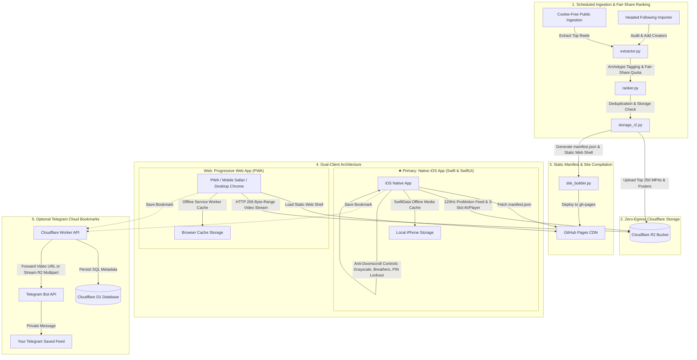

<div align="center">
  
  <h1>📱 The Anti-Doomscroll Briefing</h1>
  <p><strong>An intentional, finite, ad-free weekly digest of Instagram Reels on native iOS & web.</strong></p>
  <p>Replaces algorithmic doom-scrolling with a finite, curated media briefing. Stream high-bitrate video via Cloudflare R2 and sync permanent bookmarks to Telegram — <strong>100% free forever ($0.00/mo)</strong>.</p>

  <p>
    <a href="LICENSE"></a>
    <a href="#-native-ios-app-installation-primary"></a>
    <a href="#-web-pwa-backup-no-install"></a>
    <a href="#-the-000-forever-zero-cost-architecture"></a>
    <a href="#5-permanent-telegram-cloud-bookmarks"></a>
    <a href="https://www.python.org/"></a>
  </p>
</div>

---

## 📸 Visual Tour

<p align="center">
  
  
  
  
</p>

<p align="center">
  <em>(Left to Right: Full-Screen Vertical Feed · 3-Column Visual Grid View · The 10 Traps Manifesto · Anti-Doomscroll Wellbeing Controls)</em>
</p>

---

## 💡 Why Instagram Digest?

Mainstream social media apps are engineered for **infinite retention** — optimizing for time-on-screen rather than signal. You open an app to check one creator and emerge 45 minutes later trapped in an algorithmic rabbit hole of low-value dopamine loops.

**Instagram Digest systematically neutralizes this trap:**
1. **Finite Weekly Batches:** Delivers a capped weekly digest of the top 250 reels from creators you specifically choose, plus high-engagement discovery.
2. **Strict Watched Tracking:** Reels are automatically marked as watched as you swipe past. Unwatched items are prioritized; watched items are dimmed.
3. **Celebratory Finish:** When you reach the end, you are greeted with a *"You're All Caught Up! 🎉"* milestone — no endless algorithmic auto-play.
4. **Mindful Pace:** Daily watch quotas (10m, 20m, 30m, 45m) with gentle pause reminders or hard PIN lockouts.

> 📖 **The Anti-Doomscroll Philosophy:** Instagram Digest directly neutralizes the 10 psychological addiction traps exposed in the Satvic Movement investigation [*The Brain Behind Your Phone Addiction. We Caught Him!*](https://youtu.be/FmLJbYBu094).

| # | Trap in Social Media | How Instagram Digest Solves It |
|---|---|---|
| 1 | **Infinite Scrolling** | **Finite Weekly Cap:** 250 curated reels, followed by an explicit "All Caught Up" screen. |
| 2 | **The Red Colour Trap** | **Quiet-Luxury Aesthetics:** Zero red notification badges. Frosted slate tones and 1-tap Grayscale mode. |
| 3 | **Gamified Validation** | **Metrics Stripped:** Zero follower counts, like counts, view tallies, or public comment threads. |
| 4 | **Variable Reward (Casino Logic)** | **Predictable Delivery:** Deterministic ranking or pure chronological sort order. No roulette refresh. |
| 5 | **Algorithmic Rabbit Holes** | **Channel Archetypes:** Whitelist curation balancing `Educational`, `Craft`, `Lifestyle`, and `Vlog` creators. |
| 6 | **Sensory Dopamine Overload** | **Hardware Grayscale Detox:** 1-tap monochrome filter to remove visual stimulation. |
| 7 | **Artificial Urgency (FOMO)** | **Asynchronous Weekly Briefing:** Zero 24h disappearing stories or live streams. Read on your schedule. |
| 8 | **Hypnotic Trance State** | **Active Friction:** Choose between Auto mode (0.5s pause) and Manual advance, plus optional 3s inter-reel breathers. |
| 9 | **Vanity Comparison** | **Neutrality Mode:** 1-tap toggle to hide rank badges (`#01`, `#02`) across the feed and grid. |
| 10 | **Frictionless Habit Loop** | **Session Time-Boxing:** Daily watch quotas with mindful break prompts or hard 4-digit PIN lockouts. |

---

## ✨ 5 Core Pillars

### 1. ★ Native iOS App Experience (Primary Tier)
* **120Hz ProMotion Fluidity:** Pure Swift & SwiftUI interface delivering butter-smooth vertical paging with native iOS gesture physics.
* **0ms Instant Video Playback:** Multi-slot `AVPlayer` background pre-buffering completely eliminates black screens, spinners, and thumbnail loading delay.
* **100% Offline Flight Mode:** One-tap download caches the entire weekly digest to your iPhone storage using SwiftData for uninterrupted offline travel.
* **Intuitive Media Gestures:**
  - **Tap Screen:** Instant play/pause toggle.
  - **Press-and-Hold Right Edge:** Latches `2.0x` fast-forward speed with a visual indicator pill. Tap again to return to 1.0x.
  - **Horizontal Scrubbing HUD:** Drag horizontally for real-time seek scrubbing with timestamp preview.

### 2. Anti-Doomscroll Psychology & Active Friction
* **Auto vs. Manual Advance:** Choose between `Auto` (effortless playback with 0.5s pause) and `Manual` (playback pauses at reel completion until you deliberately swipe).
* **3-Second Breathing Space:** Optional 3-second countdown toast between reels that breaks unconscious hypnotic trance states.
* **Hardware-Accelerated Grayscale:** Instantly strips hyper-saturated colors across the entire app with zero performance penalty.
* **Neutrality Mode:** Hides `#01`, `#02` rank numbers to remove comparative judgment and let you appreciate content for its intrinsic value.

### 3. Session Time-Boxing & Hard Lockout
* **Daily Watch Quotas:** Select a healthy daily media limit: **10 min**, **20 min**, **30 min**, or **45 min**.
* **Gentle Pause vs. Hard Lockout:**
  - `Gentle Pause`: Displays a calm mindful reminder toast with an option to take a break or snooze.
  - `Hard Lockout`: Full-screen blur that requires entering a private 4-digit PIN to unlock, preventing impulsive over-consumption.

### 4. Channels You Actually Value & Zero-Cookie Import
* **Additive Creator Onboarding (`--import-following`):** Log in once via an interactive, headed browser window to import creators you follow. Pre-existing channels are safely preserved — no wiped lists, zero stored passwords, zero saved cookies.
* **Intentional Archetypes:** Categorize creators into `Educational`, `Craft`, `Lifestyle`, and `Vlog`. The fair-share ranking engine ensures no single creator dominates your feed.
* **High-Density 3-Column Explore Grid:** Tap `⊞` (or press `V` on desktop) to browse all 250 reels at once with instant search by creator handle or caption keywords.

### 5. Permanent Telegram Cloud Bookmarks
* **Permanent Cloud Saving:** Tap `🔖 Save` on any reel to bookmark it forever.
* **Automatic Telegram Bot Forwarding:** Saved reels are forwarded directly to your private Telegram chat, serving as an unlimited, free, permanent cloud media archive that doesn't consume your phone storage.

---

## 🏗️ System Architecture



---

## 📲 App Installation

### ★ Native iOS App Installation (Primary)

The native iOS app is compiled and packaged automatically on every release via GitHub Actions.

1. **Download the latest IPA:**
   - Go to your repository's [Actions Tab](../../actions) -> **Build InstagramDigest iOS App**.
   - Download the `InstagramDigest-Unsigned-IPA` artifact (or grab it from `dist/ipa/InstagramDigest-latest.ipa`).
2. **Install on your iPhone:**
   - **AltStore / Sideloadly / TrollStore:** Drag and drop `InstagramDigest.ipa` to install and sign with your free Apple ID.
   - **Xcode (Mac):** Open `InstagramDigest.xcodeproj`, select your connected device, and press `Cmd+R`.
3. Launch the app and enjoy 120Hz ProMotion playback, 0ms switching, and full offline caching!

---

### 🌐 Web PWA (Backup / No Install)

If you cannot sideload the native app, the Progressive Web App (PWA) gives you instant access from any browser:

#### iOS Safari
1. Open your digest URL in Safari: `https://<user>.github.io/Instagram_digest/?pin=1234`
2. Tap **Share** -> **Add to Home Screen**.
3. Tap **Add**. Launching from your home screen opens the briefing in full-screen standalone mode without browser chrome.

#### Android Chrome
1. Open your digest URL in Chrome.
2. Tap the three-dot menu -> **Install app** or **Add to Home Screen**.

---

## 🚀 Setup & Weekly Ingestion Pipeline

### Step 1: Clone Repository & Install Dependencies

```bash
git clone https://github.com/<your-username>/Instagram_digest.git
cd Instagram_digest

# Create virtual environment with Python 3.10+
python3 -m venv .venv
source .venv/bin/activate

# Install dependencies and browser tools
pip install -r requirements.txt
playwright install chromium
```

---

### Step 2: Cloudflare Setup (R2 Video Storage)

1. Log into your [Cloudflare Dashboard](https://dash.cloudflare.com/) and go to **R2**.
2. Click **Create bucket** and name it `instagram-digest`.
3. Under **Settings** -> **Public access**, enable your **R2.dev subdomain** (or connect a custom domain).
4. Create an API Token under **Manage R2 API Tokens** with `Object Read & Write` permissions.

---

### Step 3: Configure Environment (`.env`)

Copy `.env.example` to `.env`:
```bash
cp .env.example .env
```

Fill in your Cloudflare R2 credentials and GitHub Pages URL:
```env
# Cloudflare R2 Video Storage (10 GB Free Tier, $0.00 Egress)
R2_ACCOUNT_ID=<your-cloudflare-account-id>
R2_ACCESS_KEY_ID=<your-r2-access-key-id>
R2_SECRET_ACCESS_KEY=<your-r2-secret-access-key>
R2_BUCKET_NAME=instagram-digest
R2_PUBLIC_DOMAIN=https://<your-bucket-domain>.r2.dev

# GitHub Pages Deployment
GH_PAGES_REPO=https://github.com/<your-username>/Instagram_digest.git
PAGES_BASE_URL=https://<your-username>.github.io/Instagram_digest

# Security PIN for Web PWA Gating
VIEWING_PIN=1234
```

---

### Step 4: Import Channels & Run Ingestion

```bash
# Additive import: import followed channels interactively without saving credentials
python main.py --import-following

# Run weekly sync, score videos, upload to R2, and deploy manifest to GitHub Pages:
python main.py --sync --deploy
```

Once deployment completes, enable GitHub Pages in your repository under **Settings** -> **Pages** (Branch: `gh-pages`, Folder: `/ (root)`).

---

### Step 5: Automated Weekly Scheduling

To update your digest every week automatically, add a cron job on your computer or server (`crontab -e`):
```cron
# Runs every Saturday at 18:00
0 18 * * 6 cd /path/to/Instagram_digest && ./run_weekly.sh >> logs/cron.log 2>&1
```

---

## 💰 The $0.00 Forever Zero-Cost Architecture

Every infrastructure component was selected to fit entirely within permanently free tiers:

| Component | Provider & Service | Free Tier Allowance | Instagram Digest Usage | Monthly Cost |
| :--- | :--- | :--- | :--- | :--- |
| **Manifest & Web Hosting** | **GitHub Pages** | Unlimited public bandwidth, 1 GB storage | ~2 MB static bundle | **$0.00** |
| **Video Streaming** | **Cloudflare R2** | 10 GB storage / month, **$0.00 egress fees** | ~2–4 GB active weekly digest | **$0.00** |
| **Bookmarks API** | **Cloudflare Workers** | 100,000 requests / day | ~50–100 requests / day | **$0.00** |
| **Bookmarks Database** | **Cloudflare D1** | 5M read rows / mo, 100k write rows / mo | < 1,000 rows / mo | **$0.00** |
| **Media Cloud Archive** | **Telegram Bot API** | Unlimited cloud file storage & bandwidth | Unlimited bookmarked video forwarding | **$0.00** |
| **Scheduled Ingestion** | **Local Machine / VPS** | Runs on your existing computer | ~15 min cron once per week | **$0.00** |
| **TOTAL** | | | | **$0.00 / mo** |

> [!TIP]
> Traditional video streaming platforms incur heavy bandwidth egress fees ($0.05–$0.09 per GB). Cloudflare R2's **zero-egress-fee policy** is the critical architectural pillar that allows gigabytes of video streaming at absolute zero cost.

---

## ⌨️ Desktop Keyboard Shortcuts

| Shortcut | Action | Description |
| :--- | :--- | :--- |
| `Space` | **Play / Pause** | Toggles video playback |
| `ArrowDown` / `J` | **Next Reel** | Advances to next reel in active category |
| `ArrowUp` / `K` | **Previous Reel** | Returns to previous reel |
| `V` | **Toggle Grid View** | Opens / closes 3-column explore grid |
| `F` | **Fullscreen** | Toggles native browser fullscreen |
| `Escape` | **Close Overlays** | Closes Grid View, Bookmarks, or Modals |

---

## 🛠️ CLI Reference

* **Full Weekly Sync & Deploy:** `python main.py --sync --deploy`
* **Midweek Refresh (New reels only):** `python main.py --ad-hoc --deploy`
* **Expand Digest (+N reels):** `python main.py --expand 50 --deploy`
* **Local Offline Server (Port 8080):** `python main.py --serve --port 8080`
* **Rebuild Static Site (Zero network calls):** `python main.py --build-only`
* **Run Test Suite:** `.venv/bin/pytest tests/ -q`

---

## 🔒 Privacy & Security Posture

* **No Credentials Stored:** Account passwords and authentication cookies are never persisted.
* **No Trackers or Analytics:** Zero tracking scripts, tracking pixels, or third-party behavioral telemetry.
* **Private Cloud Forwarding:** Bookmarked videos stream directly to your personal Telegram chat via encrypted bot tokens.

---

## 📄 License

Distributed under the **MIT License**. See [LICENSE](LICENSE) for more information.
