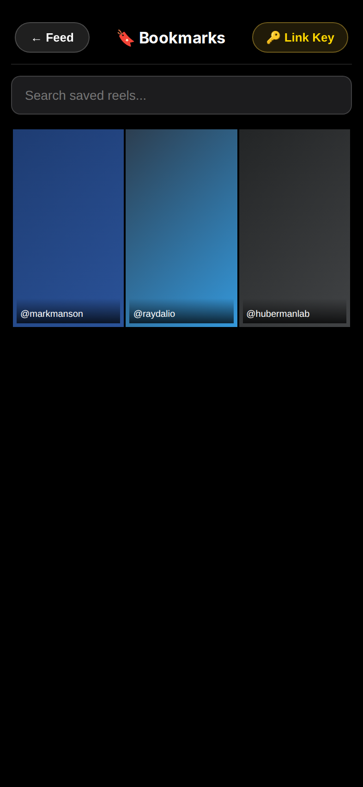
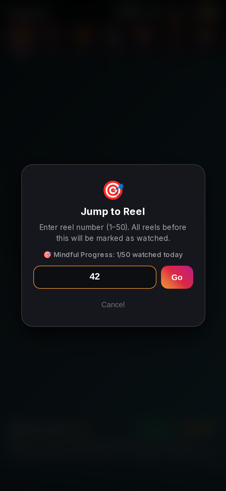
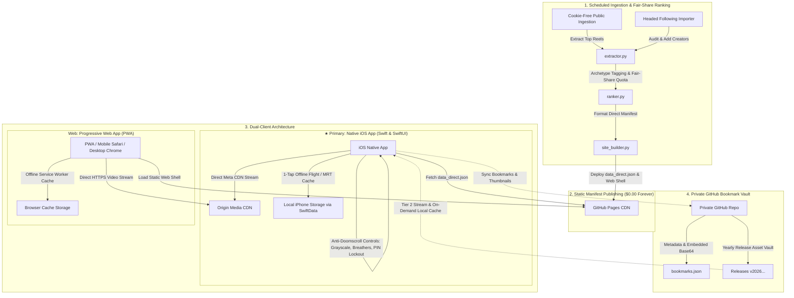

<p align="center">
  
</p>

<h1 align="center">📱 The Anti-Doomscroll Briefing</h1>

<p align="center">
  <strong>An intentional, finite, ad-free weekly digest of Instagram Reels on native iOS & web.</strong><br>
  Replaces algorithmic doom-scrolling with a finite, curated media briefing. Streams high-bitrate video directly via Meta CDN and syncs permanent bookmarks to your private GitHub repository — <strong>100% free forever ($0.00/mo)</strong>.
</p>

<p align="center">
  <a href="LICENSE"></a>
  <a href="#-native-ios-app-installation-primary"></a>
  <a href="#-web-pwa-backup-no-install"></a>
  <a href="#-the-000-forever-zero-cost-architecture"></a>
  <a href="#5-private-github-bookmark-vault"></a>
  <a href="https://www.python.org/"></a>
</p>

---

## 📸 Visual Tour

<p align="center">
  
  
  
  
</p>

<p align="center">
  <em>(Left to Right: Full-Screen Vertical Feed · 3-Column Visual Grid View · Hybrid Bookmarks Library · Mindful Jump Dialog)</em>
</p>

---

## 💡 Why This Exists — Neutralizing The 10 Traps of Phone Addiction

Mainstream social media apps are behavioral casinos engineered for **infinite retention** — maximizing time-on-screen rather than user wellbeing.

This project was built as an open-source, engineering-first antidote to the 10 psychological traps exposed in the viral investigative documentary by **Satvic Movement**:  
🎬 **Watch the investigation:** [*"The Brain Behind Your Phone Addiction. We Caught Him!"*](https://www.youtube.com/watch?v=FmLJbYBu094)

Here is how **The Anti-Doomscroll Briefing** directly dismantles every single trap in code:

| # | Trap from the Video | The Psychological Trap | How This Repo Solves It | Status |
|---|---|---|---|:---:|
| 1 | **Infinite Scroll** | Eliminates natural stopping cues so the brain never decides to exit. | **Hard Weekly Cap:** Finite batch of customizable reels (e.g. 150), followed by an explicit celebratory *"You're All Caught Up! 🎉"* milestone. No endless feed. | **Solved** |
| 2 | **The Red Colour Trap** | Red notification dots exploit primal threat/urgency reflexes to compel clicks. | **Quiet-Luxury Aesthetics:** Zero red notification badges or alarm dots. Frosted OLED slate tones and a 1-tap **Hardware Grayscale Mode**. | **Solved** |
| 3 | **Gamified Social Obligation** | Streaks, interaction scores, and follow ratios exploit fear of social rejection. | **Zero Social Graph:** Completely severed social graph. No follower counts, streaks, or social debt loops. | **Solved** |
| 4 | **Variable Reward (Casino Logic)** | Pull-to-refresh roulette; unpredictability triggers dopamine spikes like a slot machine. | **Deterministic Static Digest:** Predictable curated score ranking or pure chronological sort. Zero pull-to-refresh roulette. | **Solved** |
| 5 | **Filtered Reality & Envy** | Hyper-curated algorithmic feeds optimize for envy, drama, and artificial lifestyle comparisons. | **Channel Archetypes:** Whitelist ingestion balancing intentional categories (`Educational`, `Craft`, `Lifestyle`, `Vlog`) with strict fair-share creator caps. | **Solved** |
| 6 | **Social Validation Metrics** | Like counts, view tallies, and comment threads hijack the brain's validation circuitry. | **Metrics Stripped:** Like counts, views, and comment threads are completely removed. Includes a **Neutrality Mode** to hide even rank badges (`#01`, `#02`). | **Solved** |
| 7 | **Artificial Urgency (FOMO)** | 24-hour disappearing stories and live pings force compulsive daily checking. | **Asynchronous Weekly Batch:** Published once a week on your schedule (e.g. Saturdays 18:00); reels remain accessible offline with zero disappearing FOMO feeds. | **Solved** |
| 8 | **Hypnotic Trance State** | Frictionless 0-effort autoplay lulls the prefrontal cortex into a passive zombie state. | **Active Playback Friction:** Choose between Auto mode (0.5s pause) and Manual advance (swiping required to proceed), plus optional **3-second inter-reel breathers**. | **Solved** |
| 9 | **Sensory & Dopamine Overload** | Hyper-saturated colors and aggressive jump cuts trigger continuous neural stimulation. | **1-Tap Grayscale Detox:** Hardware-accelerated monochrome filter strips all saturation from video and interface with zero latency. | **Solved** |
| 10 | **The Buzz (Frictionless Re-entry)** | Push notifications and vibration pings pull you back into the loop multiple times per day. | **Pull-Only Architecture & Hard PIN Lockout:** Zero push notifications. Configurable daily watch-time quotas (10/20/30/45m) backed by a hard **4-digit PIN lockout**. | **Solved** |

---

## ✨ 5 Core Pillars

### 1. ★ Native iOS App Experience (Primary Tier)
* **120Hz ProMotion Fluidity:** Pure Swift & SwiftUI interface delivering butter-smooth vertical paging with native iOS gesture physics and Swift 6 complete concurrency safety.
* **Direct Meta CDN Streaming:** Instant high-definition video playback streaming directly from origin HTTPS endpoints without third-party proxy lag or video re-encoding overhead.
* **1-Tap Offline Flight / Underground MRT Mode:** Download the entire weekly digest to your iPhone's local storage in one tap using SwiftData for uninterrupted commuting and offline flights.
* **Multi-Slot AVPlayer Background Pre-Buffering:** Next and previous reel players are pre-warmed in background slots, eliminating buffering spinners and black frames during swipes.
* **Intuitive Media Gestures:**
  - **Tap Screen:** Instant play/pause toggle.
  - **Press-and-Hold Right Edge:** Latches `2.0x` fast-forward speed with a visual indicator pill. Tap again to return to 1.0x.
  - **Horizontal Scrubbing HUD:** Drag horizontally for real-time seek scrubbing with timestamp preview.

### 2. Anti-Doomscroll Psychology & Active Friction
* **Auto vs. Manual Advance:** Choose between `Auto` (effortless playback with 0.5s pause) and `Manual` (playback pauses at reel completion until you deliberately swipe).
* **3-Second Breathing Space:** Optional 3-second countdown toast between reels that breaks unconscious hypnotic trance states.
* **Hardware-Accelerated Grayscale:** Instantly strips hyper-saturated colors across the entire app with zero performance penalty.
* **Neutrality Mode:** Hides `#01`, `#02` rank numbers to remove comparative judgment and let you appreciate content for its intrinsic value.

### 3. Session Time-Boxing & Hard Lockout
* **Daily Watch Quotas:** Select a healthy daily media limit: **10 min**, **20 min**, **30 min**, or **45 min**.
* **Gentle Pause vs. Hard Lockout:**
  - `Gentle Pause`: Displays a calm mindful reminder toast with an option to take a break or snooze.
  - `Hard Lockout`: Full-screen blur that requires entering a private 4-digit PIN to unlock, preventing impulsive over-consumption.

### 4. Channels You Actually Value & Zero-Cookie Import
* **Additive Creator Onboarding (`--import-following`):** Log in once via an interactive, headed browser window to import creators you follow. Pre-existing channels are safely preserved — no wiped lists, zero stored passwords, zero saved cookies.
* **Intentional Archetypes:** Categorize creators into `Educational`, `Craft`, `Lifestyle`, and `Vlog`. The fair-share ranking engine ensures no single creator dominates your feed.
* **High-Density 3-Column Explore Grid:** Tap `⊞` (or press `V` on desktop) to browse all curated reels at once with instant search by creator handle or caption keywords.

### 5. Private GitHub Bookmark Vault
* **Permanent Self-Hosted Backup:** Saved reels are securely synced to your private GitHub repository (`bookmarks.json`) and release asset vault (`v{year}`).
* **Self-Contained Thumbnails:** Thumbnails are embedded directly into `bookmarks.json` as base64 and mirrored in your repository's `thumbnails/` directory. Newly synced devices display rich visual cards immediately without network calls.
* **Multi-Tier Resilient Playback Engine:**
  - **Tier 1 (Local Disk Vault):** Instant zero-latency offline playback from local cache.
  - **Tier 1.5 (Active-Week Direct Stream):** Fast-path playback for reels from the active weekly digest.
  - **Tier 2 (GitHub Release Streaming):** Direct streaming from your private GitHub Release vault with on-demand background caching.
  - **Tier 3 (Instagram Web Fallback):** Direct one-tap jump to view the original reel on Instagram.
* **Automatic Storage Cap (LRU Pruning):** Configurable local cache ceiling (default: latest 50 videos). As you bookmark new videos, older local MP4s are evicted automatically while bookmark metadata, captions, and thumbnails remain preserved permanently.
* **Cellular-Safe Background Caching:** Automatic video downloads are paused while on cellular or expensive connections, preserving your mobile data plan.

---

## 🏗️ System Architecture



---

## 📲 App Installation

### ★ Native iOS App Installation (Primary)

The native iOS app is compiled and packaged automatically on every release via GitHub Actions.

1. **Download the latest IPA:**
   - Go to your repository's [Actions Tab](../../actions) -> **Build InstagramDigest iOS App**.
   - Download the `InstagramDigestDirect-Unsigned-IPA` artifact.
2. **Install on your iPhone:**
   - **AltStore / Sideloadly / TrollStore:** Drag and drop `InstagramDigestDirect.ipa` to install and sign with your Apple ID.
   - **Xcode (Mac):** Open `InstagramDigest.xcodeproj`, select your connected iPhone, and press `Cmd+R`.
3. Launch the app and enjoy 120Hz ProMotion playback, 0ms switching, and full offline caching!

---

### 🌐 Web PWA (Backup / No Install)

If you cannot sideload the native app, the Progressive Web App (PWA) gives you instant access from any browser:

#### iOS Safari
1. Open your digest URL in Safari: `https://<user>.github.io/Instagram_digest/?pin=1234`
2. Tap **Share** -> **Add to Home Screen**.
3. Tap **Add**. Launching from your home screen opens the briefing in full-screen standalone mode without browser chrome.

#### Android Chrome
1. Open your digest URL in Chrome.
2. Tap the three-dot menu -> **Install app** or **Add to Home Screen**.

---

## 🚀 Setup & Weekly Ingestion Pipeline

### Step 1: Clone Repository & Install Dependencies

```bash
git clone https://github.com/<your-username>/Instagram_digest.git
cd Instagram_digest

# Create virtual environment with Python 3.10+
python3 -m venv .venv
source .venv/bin/activate

# Install dependencies and browser tools
pip install -r requirements.txt
playwright install chromium
```

---

### Step 2: Configure Environment (`.env`)

Copy `.env.example` to `.env`:
```bash
cp .env.example .env
```

Configure your repository settings:
```env
# GitHub Pages Deployment
GH_PAGES_REPO=https://github.com/<your-username>/Instagram_digest.git
PAGES_BASE_URL=https://<your-username>.github.io/Instagram_digest

# Security PIN for Web PWA Gating
VIEWING_PIN=1234

# Enable Direct Stream Mode (Default: true)
DIRECT_STREAM_MODE=true
```

---

### Step 3: Import Channels & Run Ingestion

```bash
# Additive import: import followed channels interactively without saving credentials
python main.py --import-following

# Run weekly sync, score videos, and deploy manifest to GitHub Pages:
python main.py --sync --deploy
```

Once deployment completes, enable GitHub Pages in your repository under **Settings** -> **Pages** (Branch: `gh-pages`, Folder: `/ (root)`).

---

### Step 4: Automated Weekly Scheduling

To update your digest every week automatically, add a cron job on your computer or server (`crontab -e`):
```cron
# Runs weekly on your preferred schedule (e.g. Saturdays 18:00)
0 18 * * 6 cd /path/to/Instagram_digest && ./run_weekly.sh >> logs/cron.log 2>&1
```

---

## 💰 The $0.00 Forever Zero-Cost Architecture

Every infrastructure component was selected to fit entirely within permanently free tiers:

| Component | Provider & Service | Free Tier Allowance | Instagram Digest Usage | Monthly Cost |
| :--- | :--- | :--- | :--- | :--- |
| **Manifest & Web Hosting** | **GitHub Pages** | Unlimited public bandwidth, 1 GB storage | ~2 MB static bundle | **$0.00** |
| **Video Streaming** | **Direct Meta CDN** | Origin HTTPS Content Delivery | Zero external bandwidth or egress costs | **$0.00** |
| **Bookmarks Vault** | **Private GitHub Repo** | Unlimited private repositories & releases | ~5 MB JSON + yearly releases | **$0.00** |
| **Scheduled Ingestion** | **Local Machine / VPS** | Runs on your existing computer | ~15 min cron once per week | **$0.00** |
| **TOTAL** | | | | **$0.00 / mo** |

---

## ⌨️ Desktop Keyboard Shortcuts

| Shortcut | Action | Description |
| :--- | :--- | :--- |
| `Space` | **Play / Pause** | Toggles video playback |
| `ArrowDown` / `J` | **Next Reel** | Advances to next reel in active category |
| `ArrowUp` / `K` | **Previous Reel** | Returns to previous reel |
| `V` | **Toggle Grid View** | Opens / closes 3-column explore grid |
| `F` | **Fullscreen** | Toggles native browser fullscreen |
| `Escape` | **Close Overlays** | Closes Grid View, Bookmarks, or Modals |

---

## 🛠️ CLI Reference

* **Full Weekly Sync & Deploy:** `python main.py --sync --deploy`
* **Midweek Refresh (New reels only):** `python main.py --ad-hoc --deploy`
* **Expand Digest (+N reels):** `python main.py --expand 50 --deploy`
* **Local Offline Server (Port 8080):** `python main.py --serve --port 8080`
* **Rebuild Static Site (Zero network calls):** `python main.py --build-only`
* **Dry Run (Simulation):** `python main.py --dry-run`
* **Run Test Suite:** `.venv/bin/pytest tests/ -q`

---

## 🔒 Privacy & Security Posture

* **No Credentials Stored:** Account passwords and authentication cookies are never persisted.
* **Client-Side PIN Gate:** Obfuscated with PBKDF2 (200k iterations) in memory; deters casual scrapers from viewing video feeds or metadata. It is not access control — treat the Pages URL as public.
* **Zero Analytics / Tracking:** No analytics SDKs, ad networks, or invasive trackers. (Google Fonts serves the typeface — the only third-party request.)
* **Private Vault Storage:** Bookmarked reels, thumbnails, and metadata sync directly to your own private GitHub repository using fine-grained Personal Access Tokens.
